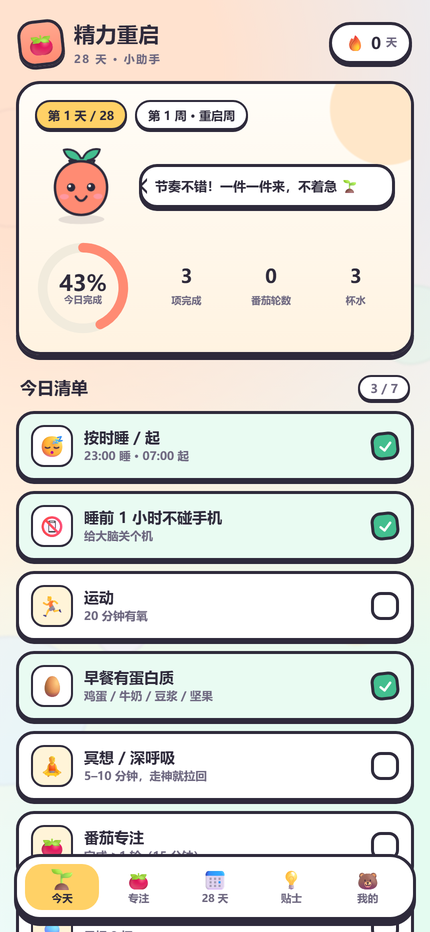

# 精力重启 · 28 天小助手

一款**卡通风、离线可用、开源免费**的 28 天精力重启小助手，用来陪你每天完成睡眠、专注、运动、饮食的小目标，把状态一点点调回来。

纯 HTML / CSS / JavaScript 手写，无框架、无依赖、无追踪、不联网也能用；数据只存在你自己的浏览器里。

🚀 **在线体验（GitHub Pages）**：<https://Tsuki1323496254.github.io/energy-reboot/>
📦 **开源仓库**：<https://github.com/Tsuki1323496254/energy-reboot>



## ✨ 功能

- **今天**：7 项每日清单（睡眠、睡前断电、运动、早餐蛋白质、冥想、番茄专注、喝水），进度环 + 连续达标天数 + 小番茄表情互动
- **专注**：番茄钟（15 / 20 / 25 / 30 分钟按周渐进，休息 5 分钟自动切换），记录今日轮数与累计分钟
- **28 天**：四周主题计划 + 每天达标情况一览（≥5/7 项算达标），进度环统计
- **贴士**：睡眠修复、注意力训练、身体充电、饮食调整、健忘对策、第一周清单
- **我的**：自定义作息时间、喝水目标、计划开始日期；导出 / 导入备份；清空数据
- 卡通风界面、卡通按钮和贴纸阴影、完成时礼花、休息/完成提示音与震动

## 🚀 三种使用方式

### 方式 1：手机直接打开（最简单）

把 `精力重启-单文件版.html` 传到手机（微信文件传输助手 / QQ / 数据线 / 网盘都行），用浏览器打开即可。所有功能都在这个文件里，**完全离线**。

- Android：用 Chrome / Edge / 夸克等浏览器打开
- iPhone：文件 App 里用「共享 → 用 Safari 打开」

### 方式 2：安装成手机 App（PWA，推荐）

1. 把整个 `精力重启小助手` 文件夹部署到任意静态网站（GitHub Pages、Netlify Drop、Vercel、自己的服务器都可以）；
   - 也可以在本机打开终端，进入文件夹执行 `python -m http.server 8080`，然后手机和电脑连同一个 Wi-Fi，访问 `http://电脑IP:8080`（局域网 http 下可正常使用，但部分浏览器不允许「安装」到桌面）。
2. 手机浏览器打开网站后：
   - **Android Chrome / Edge**：右上角菜单 → **添加到主屏幕 / 安装应用**
   - **iPhone Safari**：底部 **分享** → **添加到主屏幕**
3. 之后从桌面图标打开，就是全屏独立 App 的样子，断网也能用。

### 方式 3：电脑上开发 / 修改

```bash
# 在项目根目录
python -m http.server 8080
# 浏览器打开 http://localhost:8080
```

## 💾 数据说明

- 所有打卡记录保存在浏览器的 `localStorage` 中，**不会上传任何服务器**；
- 清理浏览器数据 / 卸载前请先在「我的 → 导出备份」保存 JSON；
- 换设备或重装后，用「导入备份」恢复。

## 🛠️ 自定义

| 想改什么 | 改哪里 |
| --- | --- |
| 每日清单项目 | `js/app.js` 里的 `CHECK_DEFS` |
| 28 天各周主题 / 任务 | `js/app.js` 里的 `WEEKS`、`WEEK_PRESET` |
| 贴士内容 | `js/app.js` 里的 `TIPS` |
| 配色 / 圆角 / 阴影 | `css/style.css` 顶部的 `:root` 变量 |
| App 图标 | `tools/make_icons.py`（改完重新运行即可） |

改完 `index.html` / `css` / `js` 后，运行 `python tools/build_single.py` 可重新生成单文件版。

## 📁 项目结构

```
energy-reboot/
├── index.html                 # 页面骨架
├── css/style.css              # 卡通风样式
├── js/app.js                  # 全部逻辑
├── manifest.webmanifest       # PWA 清单
├── sw.js                      # Service Worker（离线缓存）
├── icons/                     # 图标（192 / 512 / maskable / apple-touch / favicon）
├── tools/
│   ├── make_icons.py          # 生成图标
│   └── build_single.py        # 打包单文件版
├── 精力重启-单文件版.html      # 生成好的单文件版
├── README.md
└── LICENSE
```

## 📦 想打包成真正的 APK？（可选）

本项目是标准 PWA，可以用 [Capacitor](https://capacitorjs.com/) 或 [Bubblewrap](https://github.com/GoogleChromeLabs/bubblewrap) 打包成 Android APK：

```bash
# 需要 JDK 17 + Android SDK（Android Studio）
npm i -g @capacitor/cli
npm i @capacitor/core @capacitor/android
npx cap init "精力重启" com.example.energy28 --web-dir=.
npx cap add android
npx cap sync
cd android && ./gradlew assembleDebug
```

（需要本地安装 Android 开发环境；不打包也能直接用上面的 PWA 方式安装到桌面。）

## 📄 开源协议

[MIT](LICENSE) —— 可以自由使用、修改、分发，保留版权声明即可。

## ⚠️ 内容来源与免责声明

- 计划与贴士内容依据「28 天精力重启计划」整理，参考来源：**小荷 AI 医生**；
- 本应用仅用于生活方式调整与习惯提醒，**不构成医疗建议**；
- 如果长期存在严重失眠、情绪低落、注意力明显下降等情况，请及时就医。
